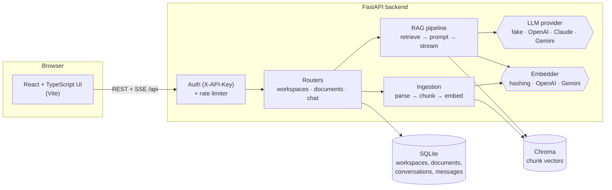

# DocMind — chat with your documents

[](https://github.com/fagundespenta/docmind/actions/workflows/ci.yml)


**[English](#english) · [Português](#português)**


---

## English

DocMind is a retrieval-augmented generation (RAG) app: upload PDFs, Word files or text
into workspaces, ask questions in plain language, and get answers that **cite the exact
passage and page** they came from, streamed token by token.

It is built like a production service rather than a notebook demo: a typed FastAPI
backend with API-key auth and rate limiting, a pluggable LLM layer (OpenAI, Anthropic
Claude, Google Gemini), a persistent vector store, a React UI, a full test suite and CI.
It also runs **100% offline** with a built-in fake LLM, so anyone can clone it and try it
without an API key.

### Features

- **Upload PDF, DOCX, TXT and Markdown.** Page-aware parsing, so citations point at the right page.
- **Recursive, overlap-aware chunking.** Splits on paragraphs, then lines, sentences and words.
- **Embeddings + Chroma vector search**, with one collection per workspace and embedding model.
- **Cited answers.** The model is instructed to cite `[1]`, `[2]`, and the UI turns each marker into a clickable source.
- **Streaming over Server-Sent Events**: sources first, then tokens, then `done`.
- **Multiple workspaces** that keep separate document collections.
- **Conversation history.** Follow-up questions carry earlier turns as context.
- **LLM provider abstraction.** Choose `fake`, `openai`, `anthropic` or `gemini` with one env var.
- **API-key auth** (`X-API-Key`) and a **per-key sliding-window rate limit** that returns `429` with `Retry-After`.
- **OpenAPI docs** at `/api/docs`, with an Authorize button.
- **Quality gates.** 50 pytest tests (chunking, parsing, retrieval on both stores, API, SSE), ruff, strict mypy, and GitHub Actions CI.
- **One-command run** with Docker Compose.

### Architecture



How a question is answered:


**Project layout**

```
backend/
  app/
    main.py            app factory, wiring, health endpoint
    config.py          typed settings from env (.env)
    db.py              SQLAlchemy 2.0 models
    security.py        API-key auth + rate limiter
    ingestion/         parsers (PDF/DOCX/TXT) and chunking
    embeddings.py      hashing (offline) / OpenAI / Gemini embedders
    vectorstore.py     Chroma + in-memory stores behind one protocol
    llm.py             fake / OpenAI / Anthropic / Gemini streaming providers
    rag.py             ingestion + retrieval + prompt building
    routers/           workspaces, documents, chat (JSON + SSE)
  tests/               pytest suite
frontend/              React + Vite + TypeScript UI (nginx in Docker)
samples/               demo documents
scripts/seed_demo.py   creates a demo workspace through the API
```

### Run it

**Option 1: Docker (one command)**

```bash
cp .env.example .env          # optional: add your LLM keys here
docker compose up --build
```

Open the UI at http://localhost:8080 and the API docs at http://localhost:8000/api/docs.
The demo API key is `dev-key`. Then load the sample documents:

```bash
python scripts/seed_demo.py --url http://localhost:8000 --key dev-key
```

**Option 2: local development**

```bash
# backend (Python 3.12)
cd backend
python -m venv .venv && source .venv/bin/activate   # Windows: .venv\Scripts\activate
pip install -e ".[dev]"
cp ../.env.example ../.env
uvicorn app.main:get_app --factory --reload --port 8000

# frontend (Node 20+), in another terminal
cd frontend
npm install
npm run dev        # http://localhost:5173, /api is proxied to :8000
```

**Quality checks**

```bash
cd backend
pytest -q          # 50 tests, fully offline
ruff check . && ruff format --check .
mypy app           # strict mode
```

### Choosing an LLM

| `LLM_PROVIDER` | Needs | Default model |
| --- | --- | --- |
| `fake` | nothing (offline, deterministic) | extractive answers with citations |
| `openai` | `OPENAI_API_KEY` | `gpt-5-mini` |
| `anthropic` | `ANTHROPIC_API_KEY` | `claude-opus-5-5` (effort via `ANTHROPIC_EFFORT`) |
| `gemini` | `GEMINI_API_KEY` | `gemini-2.5-flash` |

Embeddings are configured separately with `EMBEDDING_PROVIDER` (`fake`, `openai` or `gemini`;
Anthropic has no embeddings API). Each workspace keeps one vector collection per embedding
model, so switching providers never mixes incompatible vectors. Re-upload documents after
switching.

### API examples

```bash
KEY=dev-key
API=http://localhost:8000/api

# Create a workspace
curl -s -X POST $API/workspaces -H "X-API-Key: $KEY" \
     -H "Content-Type: application/json" -d '{"name": "Contracts"}'

# Upload a document
curl -s -X POST $API/workspaces/1/documents -H "X-API-Key: $KEY" \
     -F "file=@samples/employee-handbook.md"

# Ask (full JSON answer with sources)
curl -s -X POST $API/workspaces/1/ask -H "X-API-Key: $KEY" \
     -H "Content-Type: application/json" \
     -d '{"question": "How many vacation days do employees get?"}'

# Ask with streaming (Server-Sent Events)
curl -N -X POST $API/workspaces/1/ask/stream -H "X-API-Key: $KEY" \
     -H "Content-Type: application/json" \
     -d '{"question": "Can I work remotely?", "conversation_id": 1}'

# Semantic search only (no LLM)
curl -s "$API/workspaces/1/search?q=phishing&k=3" -H "X-API-Key: $KEY"
```

Example `/ask` response:

```json
{
  "conversation_id": 1,
  "message_id": 2,
  "answer": "Full-time employees receive 25 days of paid vacation per year [1]. Up to 5 unused days can be carried over until March 31 [1].",
  "sources": [
    { "index": 1, "document_id": 1, "filename": "employee-handbook.md", "page": null, "chunk_index": 1,
      "score": 0.41, "text": "## Paid time off\nFull-time employees receive 25 days..." }
  ]
}
```

Stream format:

```
event: sources
data: {"conversation_id": 1, "sources": [...]}

event: token
data: {"text": "Full-time "}

event: done
data: {"conversation_id": 1, "message_id": 2}
```

### Screenshots

| Light | Dark |
| --- | --- |
|  |  |


### Design notes

- **Chunks never span pages.** Each chunk maps to exactly one page, so citations stay precise.
- **Offline by default.** The hashing embedder (signed feature hashing over unigrams and bigrams) and the extractive fake LLM keep tests deterministic and fast, and the demo works with no API key.
- **Swappable components.** The vector store, embedder and LLM are small protocols. `create_app()` accepts overrides, which keeps tests simple.
- **No silent cost.** If retrieval finds nothing relevant, the API answers directly without calling the LLM.

### Roadmap

- Background ingestion queue for very large files
- OCR for scanned PDFs
- Hybrid search (BM25 + vectors) and re-ranking
- pgvector backend for Postgres deployments

---

## Português

O DocMind é uma aplicação de RAG (retrieval-augmented generation). Você envia PDFs,
arquivos do Word ou textos para workspaces, faz perguntas em linguagem natural e recebe
respostas que **citam o trecho e a página exatos** de onde vieram, transmitidas palavra por
palavra.

Foi construído como um serviço de produção, e não como um notebook de demonstração:
backend FastAPI tipado com autenticação por API key e rate limiting, camada de LLM
plugável (OpenAI, Anthropic Claude, Google Gemini), banco vetorial persistente, interface
React, suíte de testes completa e CI. Também roda **100% offline** com um LLM falso
embutido, então qualquer pessoa pode clonar e testar sem chave de API.

### Funcionalidades

- **Upload de PDF, DOCX, TXT e Markdown**, com leitura por página para as citações apontarem a página certa.
- **Chunking recursivo com sobreposição.** Divide por parágrafos, depois linhas, frases e palavras.
- **Embeddings + busca vetorial no Chroma**, com uma coleção por workspace e por modelo de embedding.
- **Respostas com citações.** O modelo cita `[1]`, `[2]`, e a interface transforma cada marcador em uma fonte clicável.
- **Streaming via Server-Sent Events**: primeiro as fontes, depois os tokens e por fim `done`.
- **Vários workspaces**, cada um com seus próprios documentos.
- **Histórico de conversas.** Perguntas de acompanhamento levam o contexto anterior.
- **Abstração de provedores de LLM.** Escolha `fake`, `openai`, `anthropic` ou `gemini` com uma variável de ambiente.
- **Autenticação por API key** (`X-API-Key`) e **rate limit por chave** (janela deslizante, `429` com `Retry-After`).
- **Documentação OpenAPI** em `/api/docs`, com botão Authorize.
- **Qualidade.** 50 testes pytest (chunking, parsing, recuperação nos dois bancos, API, SSE), ruff, mypy strict e CI no GitHub Actions.
- **Execução com um comando** via Docker Compose.

### Arquitetura

Os diagramas Mermaid da seção em inglês mostram os componentes e o fluxo de uma
pergunta. Resumo do fluxo:

1. A interface envia a pergunta para `POST /api/workspaces/{id}/ask/stream`.
2. A API gera o embedding da pergunta e busca os trechos mais parecidos no Chroma, só dentro daquele workspace.
3. As fontes são enviadas primeiro (`event: sources`).
4. O LLM recebe os trechos numerados, o histórico e a pergunta, e a resposta é transmitida (`event: token`).
5. A resposta e as fontes são salvas na conversa (`event: done`).

### Como rodar

**Opção 1: Docker (um comando)**

```bash
cp .env.example .env          # opcional: coloque aqui suas chaves de LLM
docker compose up --build
```

A interface fica em http://localhost:8080 e a documentação da API em http://localhost:8000/api/docs.
A chave de demonstração é `dev-key`. Para carregar os documentos de exemplo:

```bash
python scripts/seed_demo.py --url http://localhost:8000 --key dev-key
```

**Opção 2: desenvolvimento local**

```bash
# backend (Python 3.12)
cd backend
python -m venv .venv && source .venv/bin/activate   # Windows: .venv\Scripts\activate
pip install -e ".[dev]"
cp ../.env.example ../.env
uvicorn app.main:get_app --factory --reload --port 8000

# frontend (Node 20+), em outro terminal
cd frontend
npm install
npm run dev        # http://localhost:5173, /api é redirecionado para :8000
```

**Testes e qualidade**

```bash
cd backend
pytest -q          # 50 testes, totalmente offline
ruff check . && ruff format --check .
mypy app           # modo strict
```

### Escolhendo o LLM

| `LLM_PROVIDER` | Precisa de | Modelo padrão |
| --- | --- | --- |
| `fake` | nada (offline, determinístico) | respostas extrativas com citações |
| `openai` | `OPENAI_API_KEY` | `gpt-5-mini` |
| `anthropic` | `ANTHROPIC_API_KEY` | `claude-opus-5-5` (esforço via `ANTHROPIC_EFFORT`) |
| `gemini` | `GEMINI_API_KEY` | `gemini-2.5-flash` |

Os embeddings são configurados à parte em `EMBEDDING_PROVIDER` (`fake`, `openai` ou `gemini`;
a Anthropic não tem API de embeddings). Cada workspace mantém uma coleção vetorial por
modelo de embedding, então trocar de provedor nunca mistura vetores incompatíveis. Depois
de trocar, envie os documentos de novo.

### Exemplos de API

Os exemplos de `curl` da seção em inglês valem igualmente: criar workspace, enviar
documento, perguntar (JSON ou streaming SSE) e busca semântica sem LLM.

### Decisões de projeto

- **Chunks nunca atravessam páginas.** Cada chunk pertence a uma única página, então as citações ficam precisas.
- **Offline por padrão.** O embedder por hashing e o LLM falso extrativo deixam os testes rápidos e determinísticos, e a demonstração funciona sem chave de API.
- **Componentes trocáveis.** Banco vetorial, embedder e LLM são protocolos pequenos, e `create_app()` aceita substituições, o que simplifica os testes.
- **Sem custo escondido.** Se a busca não encontra nada relevante, a API responde direto, sem chamar o LLM.

---

Built by **Pedro Henrique Siqueira Fagundes** · MIT License
