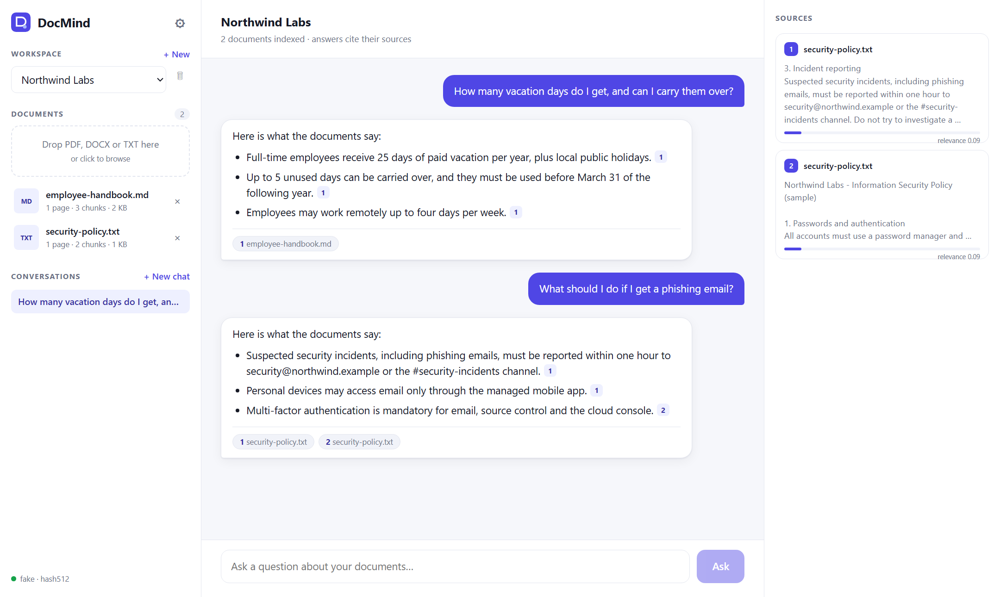
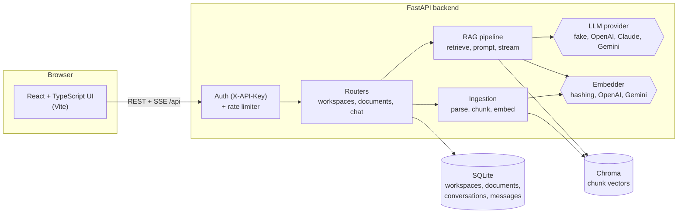
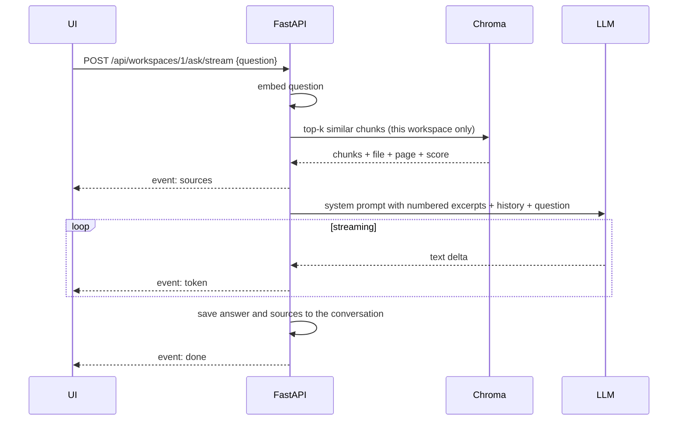
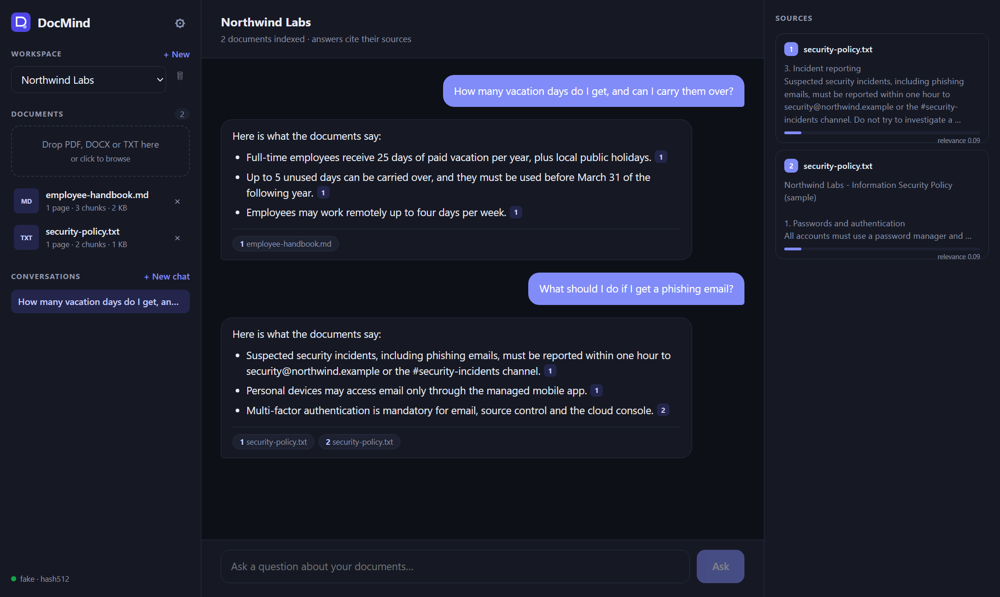
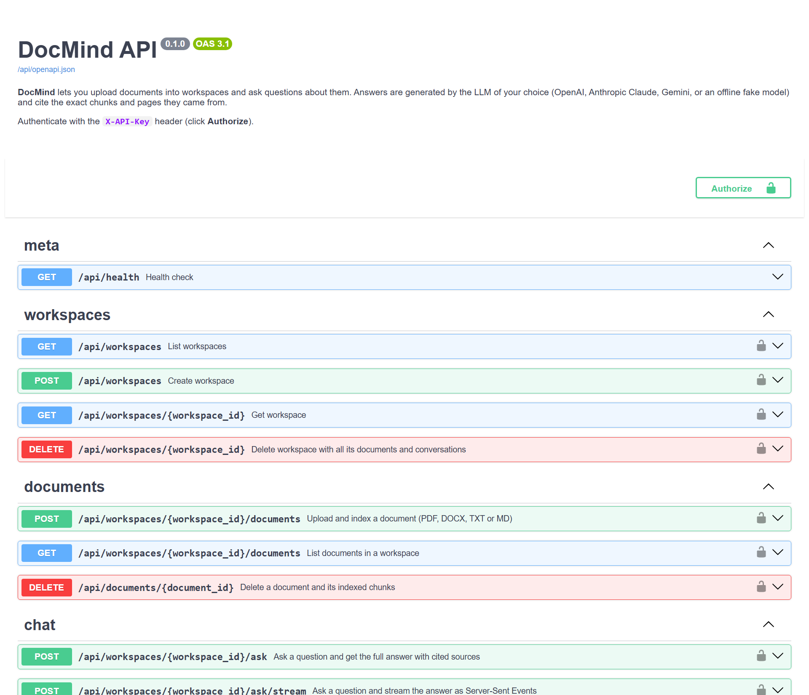

# DocMind

A retrieval-augmented generation (RAG) application for asking questions about your own documents, with answers that cite the source passage and page.



## Overview

Documents (PDF, DOCX, TXT, Markdown) are uploaded into workspaces, split into chunks, embedded and stored in a vector database. Questions are answered from the most relevant passages, and each answer is streamed to the browser with numbered citations that link back to the file and page.

The backend is a typed FastAPI service with API key authentication, rate limiting and a pluggable LLM layer (OpenAI, Anthropic Claude, Google Gemini). A built-in offline mode uses a local embedder and an extractive fake LLM, so the project can be run and tested without any API key.

## Features

- Upload of PDF, DOCX, TXT and Markdown files, with page-aware parsing.
- Recursive chunking with overlap (paragraphs, then lines, sentences and words). Chunks never span pages.
- Embeddings and vector search with Chroma, one collection per workspace and embedding model.
- Answers with numbered citations (`[1]`, `[2]`) that the UI turns into clickable sources.
- Streaming over Server-Sent Events: sources first, then tokens, then a final `done` event.
- Multiple workspaces with separate document collections.
- Conversation history, so follow-up questions keep earlier context.
- LLM provider selected through one environment variable: `fake`, `openai`, `anthropic` or `gemini`.
- API key authentication (`X-API-Key`) and a per-key sliding-window rate limit that returns `429` with `Retry-After`.
- OpenAPI documentation at `/api/docs`.
- 50 pytest tests, ruff, strict mypy and GitHub Actions CI.
- Docker Compose setup for running the full stack.

## Architecture



Request flow for a question:



Project layout:

```
backend/
  app/
    main.py            app factory, wiring, health endpoint
    config.py          typed settings from environment (.env)
    db.py              SQLAlchemy 2.0 models
    security.py        API key auth and rate limiter
    ingestion/         parsers (PDF, DOCX, TXT) and chunking
    embeddings.py      hashing (offline), OpenAI and Gemini embedders
    vectorstore.py     Chroma and in-memory stores behind one protocol
    llm.py             fake, OpenAI, Anthropic and Gemini streaming providers
    rag.py             ingestion, retrieval and prompt building
    routers/           workspaces, documents, chat (JSON and SSE)
  tests/               pytest suite
frontend/              React + Vite + TypeScript UI (served by nginx in Docker)
samples/               demo documents
scripts/seed_demo.py   creates a demo workspace through the API
```

## Tech stack

Python 3.12, FastAPI, SQLAlchemy 2.0, SQLite, Chroma, OpenAI, Anthropic and Gemini SDKs, React 18, TypeScript, Vite, nginx, Docker Compose, pytest, ruff, mypy, GitHub Actions.

## Running locally

With Docker:

```bash
cp .env.example .env
docker compose up --build
```

The UI is available at http://localhost:8080 and the API documentation at http://localhost:8000/api/docs. The demo API key is `dev-key`. To load the sample documents:

```bash
python scripts/seed_demo.py --url http://localhost:8000 --key dev-key
```

Without Docker:

```bash
# backend (Python 3.12)
cd backend
python -m venv .venv && source .venv/bin/activate   # Windows: .venv\Scripts\activate
pip install -e ".[dev]"
cp ../.env.example ../.env
uvicorn app.main:get_app --factory --reload --port 8000

# frontend (Node 20+), in a second terminal
cd frontend
npm install
npm run dev        # http://localhost:5173, /api is proxied to :8000
```

Tests and static checks:

```bash
cd backend
pytest -q
ruff check . && ruff format --check .
mypy app
```

## Configuration

| `LLM_PROVIDER` | Requires | Default model |
| --- | --- | --- |
| `fake` | nothing (offline, deterministic) | extractive answers with citations |
| `openai` | `OPENAI_API_KEY` | `gpt-5-mini` |
| `anthropic` | `ANTHROPIC_API_KEY` | `claude-opus-5-5` (effort set by `ANTHROPIC_EFFORT`) |
| `gemini` | `GEMINI_API_KEY` | `gemini-2.5-flash` |

Embeddings are configured separately with `EMBEDDING_PROVIDER` (`fake`, `openai` or `gemini`; Anthropic does not offer an embeddings API). Each workspace keeps one vector collection per embedding model, so changing providers never mixes incompatible vectors. Documents need to be uploaded again after a change. All settings are listed in `.env.example`.

## API examples

```bash
KEY=dev-key
API=http://localhost:8000/api

# Create a workspace
curl -s -X POST $API/workspaces -H "X-API-Key: $KEY" \
     -H "Content-Type: application/json" -d '{"name": "Contracts"}'

# Upload a document
curl -s -X POST $API/workspaces/1/documents -H "X-API-Key: $KEY" \
     -F "file=@samples/employee-handbook.md"

# Ask a question (JSON response with sources)
curl -s -X POST $API/workspaces/1/ask -H "X-API-Key: $KEY" \
     -H "Content-Type: application/json" \
     -d '{"question": "How many vacation days do employees get?"}'

# Ask with streaming (Server-Sent Events)
curl -N -X POST $API/workspaces/1/ask/stream -H "X-API-Key: $KEY" \
     -H "Content-Type: application/json" \
     -d '{"question": "Can I work remotely?", "conversation_id": 1}'

# Semantic search without the LLM
curl -s "$API/workspaces/1/search?q=phishing&k=3" -H "X-API-Key: $KEY"
```

Example `/ask` response:

```json
{
  "conversation_id": 1,
  "message_id": 2,
  "answer": "Full-time employees receive 25 days of paid vacation per year [1]. Up to 5 unused days can be carried over until March 31 [1].",
  "sources": [
    { "index": 1, "document_id": 1, "filename": "employee-handbook.md", "page": null, "chunk_index": 1,
      "score": 0.41, "text": "## Paid time off\nFull-time employees receive 25 days..." }
  ]
}
```

Stream format:

```
event: sources
data: {"conversation_id": 1, "sources": [...]}

event: token
data: {"text": "Full-time "}

event: done
data: {"conversation_id": 1, "message_id": 2}
```

## Design notes

- Each chunk belongs to exactly one page, which keeps citations precise.
- The hashing embedder and the extractive fake LLM keep the tests fast and deterministic, and allow the demo to run without an API key.
- The vector store, embedder and LLM are small protocols, and `create_app()` accepts overrides for testing.
- When retrieval finds nothing relevant, the API responds without calling the LLM.

## Screenshots

| Light theme | Dark theme |
| --- | --- |
|  |  |



## License

MIT. See [LICENSE](LICENSE).

---

## Português

Aplicação de RAG (retrieval-augmented generation) para fazer perguntas sobre os seus próprios documentos, com respostas que citam o trecho e a página de origem.

### Visão geral

Os documentos (PDF, DOCX, TXT, Markdown) são enviados para workspaces, divididos em trechos, convertidos em embeddings e armazenados em um banco vetorial. As perguntas são respondidas a partir dos trechos mais relevantes, e cada resposta é transmitida ao navegador com citações numeradas que apontam para o arquivo e a página.

O backend é um serviço FastAPI tipado, com autenticação por API key, rate limiting e uma camada de LLM plugável (OpenAI, Anthropic Claude, Google Gemini). Um modo offline embutido usa um embedder local e um LLM falso extrativo, então o projeto pode ser executado e testado sem nenhuma chave de API.

### Funcionalidades

- Upload de arquivos PDF, DOCX, TXT e Markdown, com leitura por página.
- Chunking recursivo com sobreposição (parágrafos, depois linhas, frases e palavras). Os trechos nunca atravessam páginas.
- Embeddings e busca vetorial com Chroma, com uma coleção por workspace e por modelo de embedding.
- Respostas com citações numeradas (`[1]`, `[2]`) que a interface transforma em fontes clicáveis.
- Streaming via Server-Sent Events: primeiro as fontes, depois os tokens e por fim o evento `done`.
- Vários workspaces, cada um com seus próprios documentos.
- Histórico de conversas, para que perguntas de acompanhamento mantenham o contexto anterior.
- Provedor de LLM escolhido por uma variável de ambiente: `fake`, `openai`, `anthropic` ou `gemini`.
- Autenticação por API key (`X-API-Key`) e rate limit por chave com janela deslizante, que retorna `429` com `Retry-After`.
- Documentação OpenAPI em `/api/docs`.
- 50 testes pytest, ruff, mypy em modo strict e CI no GitHub Actions.
- Configuração com Docker Compose para executar a aplicação completa.

### Arquitetura

Os diagramas da seção em inglês mostram os componentes e o fluxo de uma pergunta:

1. A interface envia a pergunta para `POST /api/workspaces/{id}/ask/stream`.
2. A API gera o embedding da pergunta e busca os trechos mais parecidos no Chroma, apenas dentro daquele workspace.
3. As fontes são enviadas primeiro (`event: sources`).
4. O LLM recebe os trechos numerados, o histórico e a pergunta, e a resposta é transmitida (`event: token`).
5. A resposta e as fontes são salvas na conversa (`event: done`).

### Tecnologias

Python 3.12, FastAPI, SQLAlchemy 2.0, SQLite, Chroma, SDKs da OpenAI, Anthropic e Gemini, React 18, TypeScript, Vite, nginx, Docker Compose, pytest, ruff, mypy, GitHub Actions.

### Como executar

Com Docker:

```bash
cp .env.example .env
docker compose up --build
```

A interface fica em http://localhost:8080 e a documentação da API em http://localhost:8000/api/docs. A chave de demonstração é `dev-key`. Para carregar os documentos de exemplo:

```bash
python scripts/seed_demo.py --url http://localhost:8000 --key dev-key
```

Sem Docker:

```bash
# backend (Python 3.12)
cd backend
python -m venv .venv && source .venv/bin/activate   # Windows: .venv\Scripts\activate
pip install -e ".[dev]"
cp ../.env.example ../.env
uvicorn app.main:get_app --factory --reload --port 8000

# frontend (Node 20+), em outro terminal
cd frontend
npm install
npm run dev        # http://localhost:5173, /api é encaminhado para :8000
```

Testes e verificações estáticas:

```bash
cd backend
pytest -q
ruff check . && ruff format --check .
mypy app
```

### Configuração

| `LLM_PROVIDER` | Requer | Modelo padrão |
| --- | --- | --- |
| `fake` | nada (offline, determinístico) | respostas extrativas com citações |
| `openai` | `OPENAI_API_KEY` | `gpt-5-mini` |
| `anthropic` | `ANTHROPIC_API_KEY` | `claude-opus-5-5` (esforço definido por `ANTHROPIC_EFFORT`) |
| `gemini` | `GEMINI_API_KEY` | `gemini-2.5-flash` |

Os embeddings são configurados separadamente em `EMBEDDING_PROVIDER` (`fake`, `openai` ou `gemini`; a Anthropic não oferece API de embeddings). Cada workspace mantém uma coleção vetorial por modelo de embedding, então a troca de provedor nunca mistura vetores incompatíveis. Após a troca, os documentos precisam ser enviados novamente. Todas as configurações estão listadas em `.env.example`.

### Exemplos de API

Os exemplos de `curl` da seção em inglês se aplicam da mesma forma: criar workspace, enviar documento, fazer perguntas (JSON ou streaming SSE) e busca semântica sem LLM.

### Decisões de projeto

- Cada trecho pertence a uma única página, o que mantém as citações precisas.
- O embedder por hashing e o LLM falso extrativo deixam os testes rápidos e determinísticos, e permitem executar a demonstração sem chave de API.
- Banco vetorial, embedder e LLM são protocolos pequenos, e `create_app()` aceita substituições para os testes.
- Quando a busca não encontra nada relevante, a API responde sem chamar o LLM.

### Licença

MIT. Veja [LICENSE](LICENSE).
